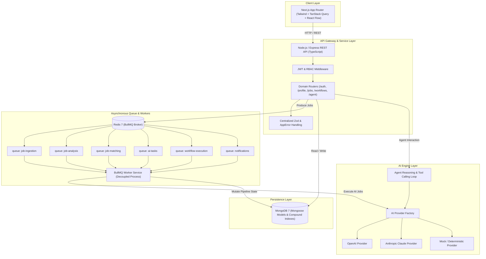

# AI JobPilot - Architecture Documentation

## 1. Executive Summary & Product Vision
**AI JobPilot** is an enterprise-grade AI-powered Job Search & Workflow Automation Platform designed to bridge deterministic backend automation with LLM-driven intelligence. Rather than functioning as a standard CRUD job board, AI JobPilot delivers an autonomous, event-driven assistant capable of scheduling job discovery, running semantic matches, executing agentic tool-calling workflows, and tracking candidate pipelines.

---

## 2. High-Level Architecture Diagram



---

## 3. Monorepo Structure

AI JobPilot uses a `pnpm` workspaces monorepo managed with Turborepo for strict boundary enforcement, lightning-fast caching, and decoupled process lifecycles.

```
mern-ai-project/
├── apps/
│   ├── api/          # Express REST API (Controller, Routes, Middleware, DI)
│   ├── worker/       # Standalone BullMQ background worker (Queues, Processors)
│   └── web/          # Next.js 15+ App Router client (Tailwind, React Flow, TanStack Query)
└── packages/
    ├── types/        # Shared TypeScript domain models, DTOs, and API contracts
    ├── config/       # Shared environment validation schemas (Zod) and constants
    ├── database/     # Resilient Mongoose connection and MongoDB schemas
    └── ai/           # AIProvider abstraction (OpenAI, Claude, Mock)
```

---

## 4. Key Architectural Pillars

### 4.1 Strict Worker Decoupling
The BullMQ background workers run in a completely isolated process (`apps/worker`). The HTTP API server (`apps/api`) does **not** process queue jobs; it only dispatches jobs to Redis. This prevents CPU-intensive AI tasks or resume parsing from degrading HTTP request latency and allows the worker cluster to scale independently.

### 4.2 Pluggable AI Provider Abstraction
The AI layer exposes an interface:
```typescript
export interface AIProvider {
  name: string;
  generateStructuredOutput<T>(prompt: string, schema: Record<string, unknown>, options?: AIOptions): Promise<T>;
  generateText(prompt: string, options?: AIOptions): Promise<string>;
  generateEmbedding(text: string): Promise<number[]>;
  executeToolCallingLoop(messages: AgentMessage[], tools: AgentTool[], options?: AgentLoopOptions): Promise<AgentRunResult>;
}
```
Switching between OpenAI, Anthropic Claude, or local/mock testing requires zero changes to core business logic—only setting `AI_PROVIDER=openai|anthropic|mock` in the environment.

### 4.3 Deterministic Hybrid Job Matching
Job matching does not rely solely on arbitrary LLM ratings. It combines:
1. **Deterministic Matching**: Skill intersection, required vs preferred skills, years of experience, remote/location fit.
2. **Vector Similarity**: Embeddings generated from resume text vs job descriptions.
3. **AI Reasoning**: Qualitative evaluation of candidate strengths, skill gaps, and custom recommendations.

### 4.4 Resilient Database & Queue Management
- **MongoDB**: Configured with automatic reconnection, keep-alive, ping health checks, and compound indexes (`source + externalId`, `userId + status`).
- **Redis & BullMQ**: Dedicated queues with exponential backoff, dead-letter recording, and concurrency controls.
- **Graceful Shutdown**: All services intercept `SIGTERM` and `SIGINT` to gracefully close active HTTP connections, stop queue processing, and flush database pools without dropping requests.
